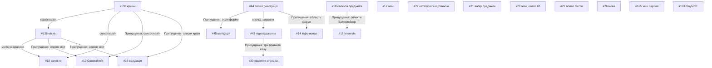

# План роботи на спринт

- Дата: 2026-11-18
- Аналіз: `Client-mvp/docs/sprint/SPRINT_ANALYSIS.md` і `BackEnd-mvp/docs/sprint/SPRINT_ANALYSIS.md`
- Команда: Учасник 1, Учасник 2, Учасник 3, Учасник 4, Учасник 5, Учасник 6, Учасник 7. Імена підставні: назвали лише кількість, семеро. Сильні сторони не названі, тому нікому не приписана роль «бекенд» чи «фронтенд».

Бали з аналізу: S = 1, M = 2, L = 3. Це спосіб порівняти ланцюжки, не години. Оцінки в аналізі позначені «Припущення:».

## Граф залежностей

Ребра взяті з розділів «Залежності» аналізу. Де аналіз сам ставить «Припущення:», те саме слово стоїть на ребрі. Нових блокувань між картками план не додає.

Жорсткі ребра:

- #138 → #128. Артефакт: зібраний сервіс країн (service, controller, route), до якого #128 додає міста. У тексті #128 стоїть старий номер #97; зв’язок саме з #138 аналіз позначає «Припущення:».
- #138 і #128 → #10. Артефакт: бекенд-сервіс локації. Контракт методу, шляху і полів у картках і в коді не зафіксований (пошук `location`, `country`, `city`, `countrystatecity` у `BackEnd-mvp/src` і `Client-mvp/src/constants/request.ts`).
- #44 → #43. Артефакт: кнопка закриття форми реєстрації.
- #44 → #45. Артефакт: попап із полями First Name, Last Name, email, Password, Confirm Password. Аналіз позначає «Припущення:», бо в тексті #45 стоїть старий номер #83, а #44 скопійована з того номера.

Ребра з позначкою «Припущення:»:

- #138 і #128 → #19 і #16. Артефакт: список країн і міст на фокусі. #19 і #16 ці номери не називають.
- #43 → #20. Артефакт: патерн трьох правил кліку з SignUp. У коді його ще немає.
- #44 → #14. Артефакт: область форми реєстрації. #14 номер #44 не називає.
- #18 → #15. Артефакт: робочі селекти категорії й предмета в `Client-mvp/src/containers/tutor-home-page/subjects-step/SubjectsStep.jsx`. #15 просить «implemented Subjects step of a tutor» і не називає номер. Критерії #15 збігаються з #18.

Без вхідних ребер, бо аналіз не знайшов блокера: #21, #76, #165, #163, #17, #72, #71, #70.

#17, #72, #71, #70 і #18 редагують один `SubjectsStep.jsx`. Це не стрілка «хто кого блокує». Це заборона паралельної правки одного файлу. Те саме для #19, #16 і #10: один `GeneralInfoStep.jsx`.

## Критичний шлях

Найдовший ланцюг, де картка прямо чекає артефакт попередньої: **#138 (2) → #128 (2) → #10 (3)**. Сума 7. Затримка #138 зсуває міста і селекти локації.

Поруч, коротший на один бал: **#44 (2) → #43 (2) → #20 (2)**. Сума 6.

Довший за обидва виходить ланцюг одного файлу. Аналіз не називає його блокером, план вибудовує його в одну чергу, бо інакше буде конфлікт злиття:

- Припущення: **#19 + #10 + #16** в `GeneralInfoStep.jsx` — 9 балів.
- Припущення: **#18 → #17 → #15** в `SubjectsStep.jsx` — 9 балів. Якщо власник продукту скаже, що хвиля #72, #71, #70 теж входить у цей файл, черга стане 18 балів і саме вона зсуне кінець спринта.

Обидві черги по 9 балів рівні. Їх тримають різні люди, тож вони йдуть паралельно. Кінець спринта зсуває та з них, яку затримають.

## Розподіл

#72, #71 і #70 у суму не входять. Вони описують той самий крок, що #18 і #17, окремого критерію приймання не мають, і аналіз лишає питання, чи нова хвиля замінює стару. Їх робить та сама пара, одним етапом після відповіді власника продукту. До відповіді друга реалізація того самого файлу не стартує.

| Учасник | Задачі | Сума |
|---|---|---|
| Учасник 1 і Учасник 2, одна гілка | #18, #17, #15. Умовно після відповіді: #72, #71, #70 | 9, умовно ще 9 |
| Учасник 3 | #44, #45, #43, #20 | 7 |
| Учасник 4 | #21, #14 | 6 |
| Учасник 5 | #138, #128, #165 | 7 |
| Учасник 6 | #19, #10, #16 | 9 |
| Учасник 7 | #76, #163 | 6 |

Суми підтверджених задач: 9, 7, 6, 7, 9, 6. Розкид від 6 до 9. Дев’ятку дають два файли, які не діляться: `SubjectsStep.jsx` і `GeneralInfoStep.jsx`. Шістку мають картки, у яких без відповіді власника продукту незрозуміло, що готове (#21, #14, #76, #163). Вигаданих задач для вирівнювання немає.

Учасник 2 не веде окремий потік. Незалежних потоків шість, людей семеро. Восьмий потік із цих карток не з’являється, тому друга людина працює в парі на найдовшій файловій черзі, предметах.

## Файли з ризиком конфлікту злиття

- `Client-mvp/src/containers/tutor-home-page/subjects-step/SubjectsStep.jsx` і `Client-mvp/src/containers/tutor-home-page/subjects-step/constants.js`. Картки #18, #17, #15, #72, #71, #70. В одному етапі їх тримає лише пара Учасник 1 і Учасник 2, одна гілка.
- `Client-mvp/src/containers/tutor-home-page/general-info-step/GeneralInfoStep.jsx`, `Client-mvp/src/components/user-steps-wrapper/constants.ts`, `Client-mvp/src/hooks/use-steps.jsx`. Картки #19, #10, #16. Лише Учасник 6.
- `Client-mvp/src/components/user-steps-wrapper/UserStepsWrapper.tsx`. #15 змінює студентський список кроків. Кроки #19, #76 і #18 цей файл уже підключає. Учасник 1 чіпає його лише для студентського кроку Interests, Учасник 7 і Учасник 6 його не переписують.
- Новий модуль локації і `BackEnd-mvp/src/routes/index.js`. Файлів локації в коді немає. Припущення: #138 і #128 створять одні й ті самі service, controller і route. Обидві картки в Учасника 5, по черзі.
- Припущення: попап реєстрації ще не існує, його місце — гостьові діалоги поруч із `Client-mvp/src/containers/guest-home-page/login-dialog/LoginDialog.jsx`. #44, #45, #43 лишаються в Учасника 3. #14 Учасник 4 складає окремим компонентом і підключає до форми лише після #44.

#165 лежить в `BackEnd-mvp/src/services/auth.js`, `BackEnd-mvp/src/services/user.js` і в тестах автентифікації. З локацією спільних файлів аналіз не називає. Учасник 5 робить їх по черзі, не одночасно з іншою людиною.

## Етапи

Етап — це порція, після якої з’являється артефакт. Не день календаря.

### Етап 1

Закрити питання зі списку нижче, без яких неясно, що приймати. Паралельно почати те, де критерії вже є.

- Учасник 5 робить #138. На початку етапу разом з Учасником 6 записує на папері метод, шлях і поля списку країн. Цього контракту в картці немає, тож це домовленість команди, не факт коду.
- Учасник 6 збирає поля імені в #19 у `GeneralInfoStep.jsx`. Селекти країни й міста поки на моку за тим папірцем. Нікого не чекає, щоб намалювати поля.
- Учасник 1 і Учасник 2 разом роблять #18: фото, селект категорій, селект предметів, хрестик. Дані категорій у цьому спринті без бекенд-картки. Для екрана беруть уже наявний `categoryService` і мок `categoriesMock` з `subjects-step/constants.js`.
- Учасник 3 робить #44, попап реєстрації. Клікабельні елементи лишаються вимкненими, як у критеріях.
- Учасник 4 збирає окремий компонент для #21 і не підключає його, доки власник продукту не скаже, коли вікно з’являється. Форму реєстрації не відкриває.
- Учасник 7 збирає вибір на `LanguageStep.jsx` за макетом. Звідки список мов, лишається питанням. До відповіді на екран можна покласти вже наявний `LanguagesEnum` і прямо підписати це припущенням у підсумку картки.

### Етап 2

- Учасник 5, після сервісу країн, робить #128. Разом з Учасником 6 дописує в той самий папірець, як у запит передається обрана країна і що лежить у списку міст.
- Учасник 6 підключає селекти #10 до мока, потім до справжнього сервісу, коли #138 і #128 віддають відповідь. Той самий файл, що в етапі 1.
- Учасник 3, коли в #44 є поля, вішає #45. Коли є хрестик форми, робить #43.
- Учасник 1 і Учасник 2, після селектів #18, додають кнопку і чіпи #17. Другий критерій #17 не кодують, доки не пояснять фразу про третій предмет.
- Учасник 4 підключає #14 лише якщо власник продукту підтвердив, що вікно живе поверх форми #44, і форма вже є. Інакше лишає компонент окремо.
- Учасник 7 закриває #76 настільки, наскільки вистачає відповіді про список мов. Якщо відповіді немає, екран не вважається зданим.

### Етап 3

- Учасник 5 робить #165. Локація вже розблокувала фронтенд, хеш пароля інших карток не блокує, але ламає вхід уже створених користувачів. Старі паролі не чіпає, доки немає відповіді про міграцію.
- Учасник 3 переносить три правила кліку з #43 на закриття степера, #20.
- Учасник 6 додає валідацію #16. Ліміт additional info не ставить, доки не вибране одне число замість 70, 100 і вже наявних 200 у `constants.ts`.
- Учасник 1 і Учасник 2 збирають #15 зі селектів #18 і підключають крок студента в `UserStepsWrapper.tsx`.
- Учасник 4 і Учасник 7 нікого не блокують. Якщо їхні питання ще відкриті, вони допомагають парі на предметах рев’ю, без другої гілки в `SubjectsStep.jsx`.

### Етап 4, лише після відповіді

Якщо власник продукту скаже, що #72, #71 і #70 замінюють #18 і #17, пара переробляє той самий `SubjectsStep.jsx`, а не веде другу копію. Якщо скаже, що це додатковий вигляд, пара додає картинку категорії і звіряє чіпи #70 з уже зробленими #17. Якщо відповіді немає, етап 4 не починається.

## Як зменшити очікування

- #138 → #128. Учасник 5 спершу заводить порожній сервіс країн і функцію «список країн», щоб #128 додавала метод міст у той самий файл, а не чекала фінального Swagger. Тести міст можуть бити в заглушку списку країн.
- #138 → #10, #19, #16. До коду ендпоінта Учасник 5 і Учасник 6 записують метод, шлях і поля. Учасник 6 кладе мок із цими полями в клієнтський виклик. Селекти малюються від мока. Коли маршрут з’являється, замінюється лише джерело даних.
- #128 → #10, #19, #16. Той самий папірець: ідентифікатор країни в запиті і поля міста у відповіді. Мок міст залежить від обраної країни, щоб селект міста не чекав зовнішній API countrystatecity.in.
- #44 → #45. Правила First Name, Last Name, email, Password, Confirm Password можна написати окремими функціями до появи попапа. Контракт полів — ці п’ять імен. Підключення до форми робить той самий Учасник 3, коли #44 їх намалює.
- #44 → #43. Діалог підтвердження з трьома правилами кліку збирається окремим компонентом. Його є до чого прив’язати лише після хрестика #44. До того Учасник 3 перевіряє правила на тестовій кнопці, не на чужій формі.
- #43 → #20. Учасник 3 не копіює поведінку на степер, доки три правила не зійшлися на формі реєстрації. Чекання коротке, бо обидві картки в нього. Окремий мок не потрібен.
- #44 → #14. Учасник 4 тримає інформаційний попап у власному файлі. Підключення до області форми відкладається, доки #44 цю область не створить і власник продукту не зніме суперечність із #43.
- #18 → #15. Учасник 2 не збирає другий набір селектів. Interests підключається до вже зібраного `SubjectsStep`. Поки селектів немає, можна лише додати підпис `interests` у список кроків і не дублювати розмітку.

## Ризики і питання на старті

Питання перенесені з аналізів. Без них план лишає картки відкритими, навіть якщо код написаний.

1. #165. Чи «decryption» означає перевірку хеша bcrypt, а не відновлення пароля? Що робити з уже збереженими відкритими паролями і з паролем суперадміна?
2. #163. Чий `.env` оновлювати, бекенд чи клієнт, де вже є `VITE_APP_TINY_MCE_API_KEY`? Що вважати готовим без чеклиста? Хто реєструє TinyMCE на пошту проєкту і як передає токен?
3. #138. Яка картка є замовником сервісу країн, якщо локальна #96 — гостьовий блок, не степер? Який контракт списку країн і чи потрібен ключ countrystatecity.in?
4. #128. Чи блокером є #138, а не локальна #97? Які шари входять у приймання без чеклиста? Який контракт міст? Чи замовники цього спринта — #10, #19 і #16?
5. #44. Які елементи макета входять у попап? У критеріях переліку немає.
6. #45. Ім’я 2–15 чи до 30, як у схемі signup і в `nameField`? Пароль — лише літера й цифра чи ще довжина 8–25?
7. #21. Коли з’являється вікно, і чи це не вже наявний `EmailConfirmModal`?
8. #14. Коли з’являється вікно? Закриття кнопкою і заборона ховати його кліком по sign-up суперечать #43.
9. #20. Чи «as it was implemented for SignUp» означає ті самі три правила кліку?
10. #19 і #16. Additional info: 70, 100 чи вже наявні 200 у `professionalSummary`? Чи завантаження країни й міста входить у валідацію #16?
11. #19. Звідки ім’я з першої реєстрації, якщо #44 не відправляє форму?
12. #10. Які поля відповіді сервісу країн і міст?
13. #76. Звідки список мов і це одна мова чи кілька?
14. #18, #15, #72, #71. Звідки категорії і предмети, якщо `GET /categories` на бекенді немає і окремої картки спринту на нього немає?
15. #17. Що означає показ третього предмета через «increasing values of rest selected subjects»?
16. #72, #71, #70. Що готове поза макетом, і чи ця хвиля замінює #18 і #17?
17. #15. Які картки є «implemented Subjects step of a tutor»?

Ризики, які видно з аналізу:

- #165 ламає вхід наявних користувачів, якщо хеш увімкнути без відповіді про старі паролі.
- Категорії навчання на клієнті вже викликаються, а бекенд-картки цього спринту їх не покривають. Селекти #18 і #15 можна зібрати на моку, здати їх як роботу з живим сервером не вийде.
- Дві хвилі кроку предметів сходяться в один файл. Друга реалізація без відповіді подвоїть роботу пари.

## Підсумок для учасників

### Учасник 1

Твої задачі: #18, потім разом з Учасником 2 #17 і #15. Після відповіді власника продукту та сама гілка бере #72, #71, #70. Від Учасника 2 ти залежиш, бо це один файл і одна гілка. Від інших карток спринта не залежиш. Ти нікого поза парою не блокуєш. #15 блокуєш сам для себе, доки селекти #18 не працюють.

### Учасник 2

Твої задачі ті самі, що в Учасника 1: одна гілка на `SubjectsStep.jsx`. Ти не ведеш окремий потік. Залежиш від Учасника 1 в тому сенсі, що селекти #18 мають з’явитися раніше за чіпи #17 і за Interests #15. Блокуєш #15 всередині пари. Інших учасників не блокуєш.

### Учасник 3

Твої задачі: #44, далі #45 і #43, потім #20. Нікого з карток не чекаєш на старті. Блокуєш себе на #45, #43 і #20. Блокуєш Учасника 4 на #14: йому потрібна область форми, якщо власник продукту підтвердить цей зв’язок.

### Учасник 4

Твої задачі: #21 і #14. Від карток на старті не залежиш: #21 аналізу не блокує ніхто. #14, за припущенням, чекає область форми від Учасника 3. Сам ти нікого не блокуєш. Обидві картки не здаються, доки власник продукту не скаже, коли вікна з’являються.

### Учасник 5

Твої задачі: #138, потім #128, потім #165. На старті нікого не чекаєш. Блокуєш Учасника 6: без сервісу країн і міст його селекти #10 лишаються на моку. #19 і #16 чекають той самий сервіс лише в частині країни й міста. #165 нікого з цих карток не блокує.

### Учасник 6

Твої задачі: #19, #10, #16, усі в `GeneralInfoStep.jsx`. Поля імені починаєш одразу. Селекти країни й міста залежать від Учасника 5 (#138 і #128). Поки контракту немає, працюєш від мока, який ви з ним запишете в етапі 1. Ти нікого не блокуєш.

### Учасник 7

Твої задачі: #76 і #163. Від карток спринта не залежиш і нікого не блокуєш. Обидві здаються лише після відповіді: звідки мови і скільки їх, і чий `.env` для TinyMCE.
